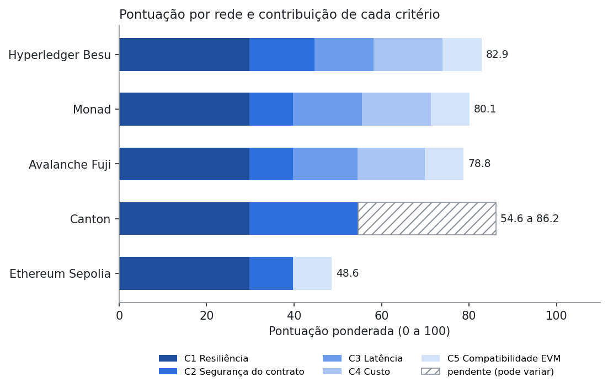
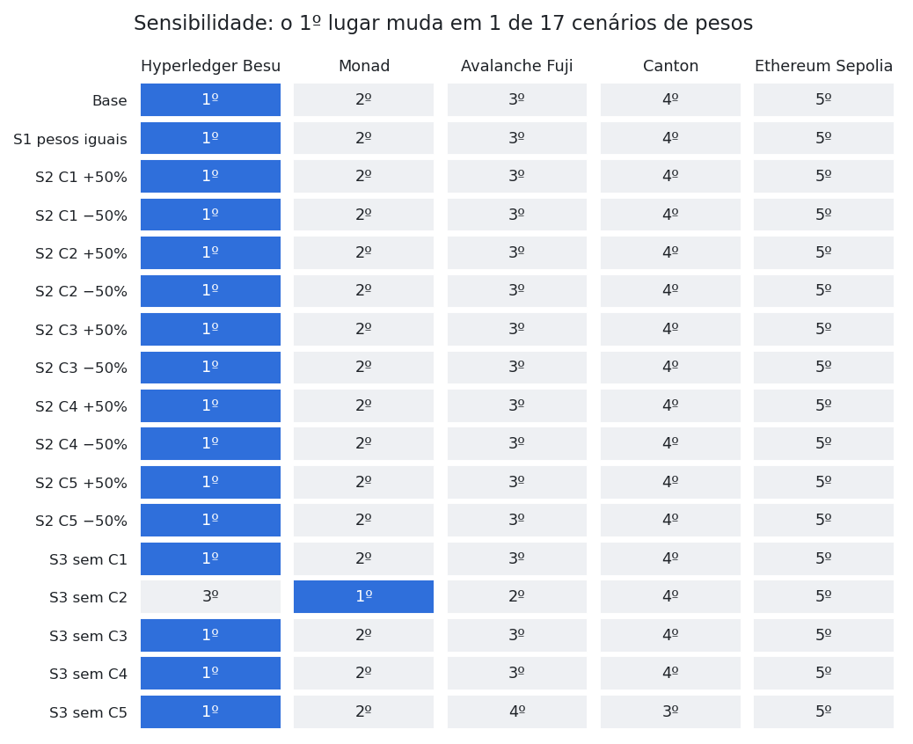

# Resultados do benchmark

> Arquivo gerado por `benchmark-redes/analise/analisar.py` em 16/10/2026 13:31 UTC. Não edite à mão: depois de cada coleta, rode `npm run analisar` dentro de `benchmark-redes/`.

Redes medidas até agora: Hyperledger Besu. Onde ainda não há medição, a matriz usa valores declarados ou projetados, marcados na tabela de notas.

## Situação da coleta

| Rede | Ambiente | T1 | T2 | Coletado em |
|---|---|---|---|---|
| Ethereum Sepolia | Testnet pública Sepolia (chain ID 11155111) | pendente | pendente | — |
| Avalanche Fuji | Testnet pública Fuji, C-Chain (chain ID 43113) | pendente | pendente | — |
| Monad | Testnet pública Monad (chain ID 10143) | pendente | pendente | — |
| Hyperledger Besu | Rede local QBFT, 4 validadores, gas grátis (chain ID 13371) | 30 aceites | 255 aceites | 2026-10-14 |
| Canton | LocalNet do cn-quickstart | pendente | pendente | — |

## Ranking atual

| Posição | Rede | C1 | C2 | C3 | C4 | C5 | Pontuação |
|---|---|---|---|---|---|---|---|
| 1 | Hyperledger Besu | 1,00 | 0,50 | 0,86 | 1,00 | 1,00 | **82,9** |
| 2 | Monad | 1,00 (hipótese) | 0,33 | 1,00 (declarado) | 1,00 (projetado) | 1,00 | **80,1** |
| 3 | Avalanche Fuji | 1,00 (hipótese) | 0,33 | 0,94 (declarado) | 0,97 (projetado) | 1,00 | **78,8** |
| 4 | Canton | 1,00 (hipótese) | 0,83 | a medir | a medir | 0,00 | **54,6 a 86,2** |
| 5 | Ethereum Sepolia | 1,00 (hipótese) | 0,33 | 0,00 (declarado) | 0,00 (projetado) | 1,00 | **48,6** |

Notas de 0 a 1 (min-max entre as cinco redes); pesos C1 29,78%, C2 29,78%, C3 15,78%, C4 15,78%, C5 8,88%. Entre parênteses, a origem quando o valor não foi medido. Pontuação em faixa: critérios ainda sem valor podem ir de 0 a 1.
C4 usa só o custo por transação (C4-M1): o custo de infraestrutura (C4-M2) ainda não foi levantado.

## Sensibilidade aos pesos

O primeiro lugar muda em 1 de 17 cenários: S3 sem C2.

## Custo por ciclo a preços da mainnet (C4-M1)

| Rede | Gas cobrado por ciclo | Preço de referência | Cotação | Custo do ciclo | Origem |
|---|---|---|---|---|---|
| Ethereum Sepolia | 422.312 | 1,106 gwei | US$ 2.433,21 | US$ 1,13700 | projetado |
| Avalanche Fuji | 422.312 | 7,544 gwei | US$ 9,85 | US$ 0,03138 | projetado |
| Monad | 522.809 | 103,000 gwei | US$ 0,0236 | US$ 0,00127 | projetado |
| Hyperledger Besu | 422.312 | — | — | US$ 0,00000 | medido |
| Canton | — | — | — | a medir | a medir |

Preços: mediana de 1 amostra(s) entre 2026-10-14T14:23 e 2026-10-14T14:23 UTC (eth_feeHistory e CoinGecko).

## Resultados por rede

### Ethereum Sepolia

**Ambiente:** Testnet pública Sepolia (chain ID 11155111).

**Situação:** aguardando coleta. Comando, dentro de `benchmark-redes/`: `npm run implantar -- --rede sepolia && npm run coletar -- --rede sepolia`.

Valores provisórios usados na matriz até a coleta:

| Critério | Valor | Fonte |
|---|---|---|
| C3 | 12,00 s | https://ethereum.org/developers/docs/consensus-mechanisms/pos/ (slot de 12 s; inclusão em pelo menos um bloco) |
| C1 | 100,0% | hipótese de empate até o T2 rodar |
| C4-M1 | US$ 1,13700 por ciclo | gas medido em besu × preço da mainnet desta rede |

### Avalanche Fuji

**Ambiente:** Testnet pública Fuji, C-Chain (chain ID 43113).

**Situação:** aguardando coleta. Comando, dentro de `benchmark-redes/`: `npm run implantar -- --rede fuji && npm run coletar -- --rede fuji`.

Valores provisórios usados na matriz até a coleta:

| Critério | Valor | Fonte |
|---|---|---|
| C3 | 1,00 s | https://docs.avax.network/solutions/performance (finalidade da C-Chain menor que 1 s; no Snowman inclusão = finalidade) |
| C1 | 100,0% | hipótese de empate até o T2 rodar |
| C4-M1 | US$ 0,03138 por ciclo | gas medido em besu × preço da mainnet desta rede |

### Monad

**Ambiente:** Testnet pública Monad (chain ID 10143).

**Situação:** aguardando coleta. Comando, dentro de `benchmark-redes/`: `npm run implantar -- --rede monad && npm run coletar -- --rede monad`.

Valores provisórios usados na matriz até a coleta:

| Critério | Valor | Fonte |
|---|---|---|
| C3 | 0,30 s | https://docs.monad.xyz/monad-arch/consensus/monad-bft (bloco mínimo de 300 ms) |
| C1 | 100,0% | hipótese de empate até o T2 rodar |
| C4-M1 | US$ 0,00127 por ciclo | gas medido em besu × preço da mainnet desta rede |

### Hyperledger Besu

**Ambiente:** Rede local QBFT, 4 validadores, gas grátis (chain ID 13371).

**Coleta:** T1 de 2026-10-14 14:21 a 14:25 UTC; T2 de 2026-10-14 15:41 a 15:42 UTC. RPC: nó próprio local. Cliente: `besu/v26.8.1/linux-x86_64/openjdk-java-25`.

**T1, latência do `acceptOffer` (C3):**

| n | Média | Mediana | p95 | Máximo | Até 30 s |
|---|---|---|---|---|---|
| 30 | 1,98 s | 1,96 s | 2,06 s | 2,07 s | 100% |

**T1, gas e custo por função (C4-M1):**

| Função | Gas médio (gas_used) | Custo médio (USD) |
|---|---|---|
| `approve` | 46.337 | 0,00000 |
| `createOffer` | 220.312 | 0,00000 |
| `acceptOffer` | 155.520 | 0,00000 |
| `cancelOffer` | 51.810 | 0,00000 |
| **Ciclo completo** | **422.312** | **0,00000** |

**T2, carga simultânea (C1):**

| Lote | Taxa de sucesso | Latência mediana sob carga | p95 sob carga |
|---|---|---|---|
| 10 | 100,0% | 1,95 s | 1,95 s |
| 25 | 100,0% | 1,83 s | 2,19 s |
| 50 | 100,0% | 1,77 s | 2,13 s |
| **Total** | **100,0%** (255 de 255) | | |

Falhas: A 0 · B 0 · C 0 · D 0 · X 0 (só D conta contra a rede).

Dados brutos: `../benchmark-redes/dados/medicoes_besu_2026-10-14.csv`.

### Canton

**Ambiente:** LocalNet do cn-quickstart.

**Situação:** aguardando coleta. Comando, dentro de `benchmark-redes/`: `npm run coletar:canton`.

Valores provisórios usados na matriz até a coleta:

| Critério | Valor | Fonte |
|---|---|---|
| C1 | 100,0% | hipótese de empate até o T2 rodar |

Sem valor provisório para C3 latência e C4-M1 custo: a pontuação desta rede aparece como faixa até a coleta.

## Gráficos

- Latência do aceite no T1: `../benchmark-redes/resultados/latencia_t1.png`
- Custo por ciclo: `../benchmark-redes/resultados/custo_ciclo.png`
- Taxa de sucesso no T2 por lote: `../benchmark-redes/resultados/sucesso_t2.png`
