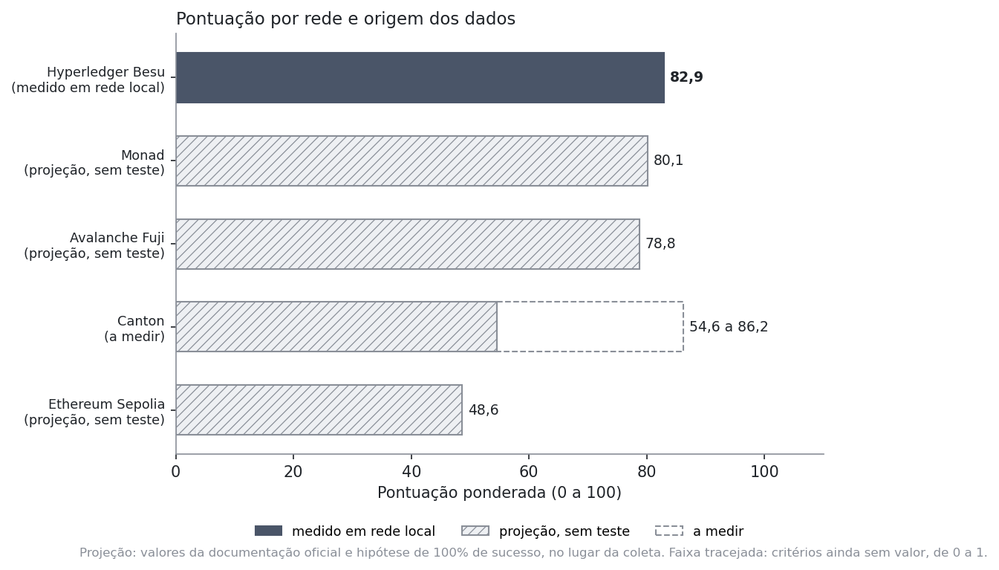
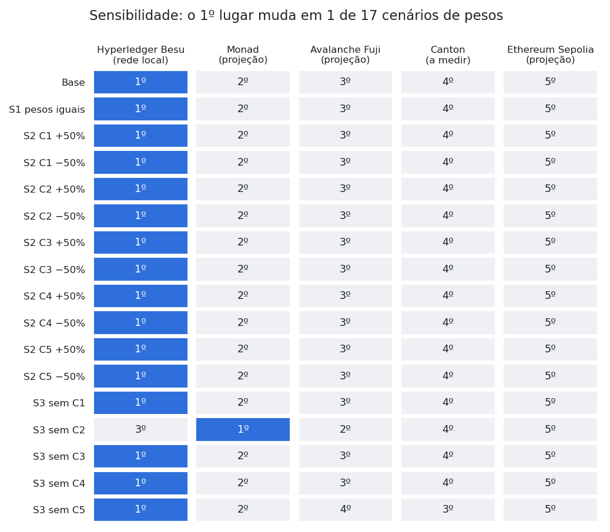
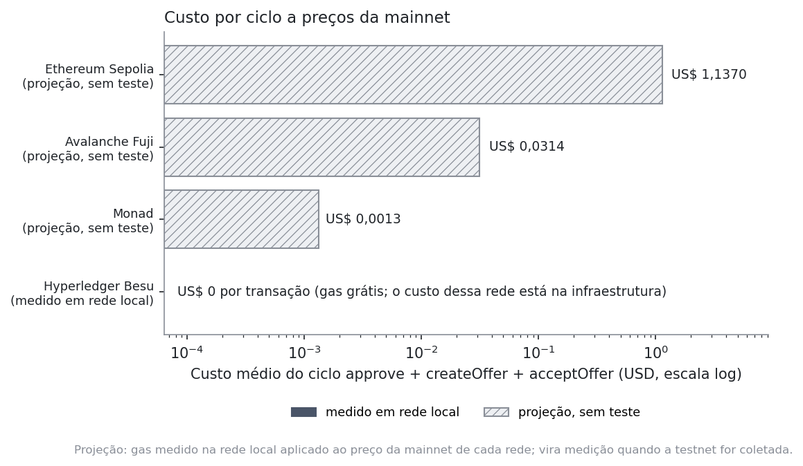
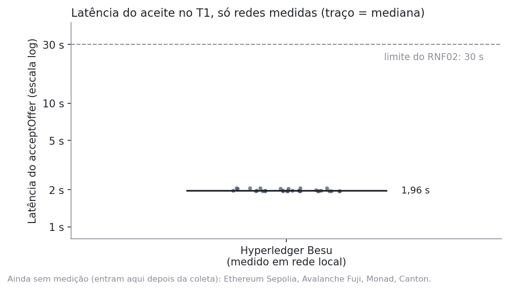
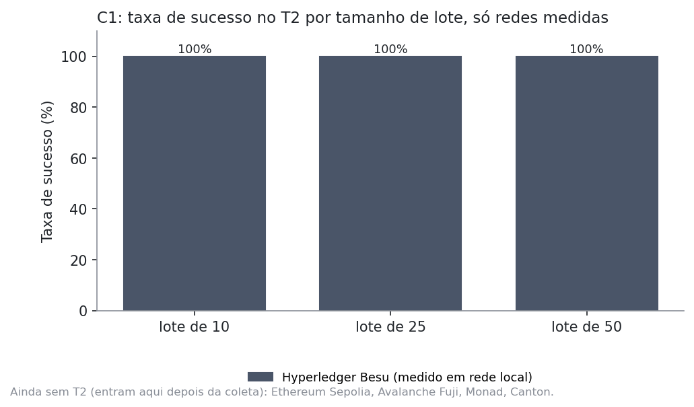

# Resultados do benchmark

> Arquivo gerado por `benchmark/analise/analisar.py` em 16/10/2026 14:06 UTC. Não edite à mão: depois de cada coleta, rode `npm run analisar` dentro de `benchmark/`.

## De onde vem cada número

| Etiqueta | Origem | O que significa | Redes hoje |
|---|---|---|---|
| `LOCAL` | Medido em rede local | A equipe rodou o contrato numa rede montada na própria máquina (Docker). Mede o protocolo de verdade, mas sem tráfego de outros usuários nem latência de internet | Hyperledger Besu |
| `TESTNET` | Medido em testnet | A equipe rodou o contrato na testnet pública da rede, com outros usuários e RPC público | — |
| `PROJEÇÃO` | Projeção, sem teste | Nenhum teste nosso: latência da documentação oficial, custo calculado com o gas medido na rede local e 100% de sucesso como hipótese | Ethereum Sepolia, Avalanche Fuji, Monad |
| `A MEDIR` | A medir | Sem teste e sem valor provisório para algum critério: a pontuação aparece como faixa | Canton |

Quando uma testnet for coletada, a linha dela passa de projeção para medido em testnet e todos os números abaixo são recalculados.

## Situação da coleta

| Rede | Tipo de ambiente | Origem dos números | T1 | T2 | Coletado em |
|---|---|---|---|---|---|
| Ethereum Sepolia | testnet pública | `PROJEÇÃO` projeção, sem teste | pendente | pendente | — |
| Avalanche Fuji | testnet pública | `PROJEÇÃO` projeção, sem teste | pendente | pendente | — |
| Monad | testnet pública | `PROJEÇÃO` projeção, sem teste | pendente | pendente | — |
| Hyperledger Besu | rede local | `LOCAL` medido em rede local | 30 aceites | 255 aceites | 2026-10-14 |
| Canton | rede local | `A MEDIR` a medir | pendente | pendente | — |

## Ranking atual (preliminar enquanto houver projeção)

| Posição | Rede | Origem | C1 | C2 | C3 | C4 | C5 | Pontuação |
|---|---|---|---|---|---|---|---|---|
| 1 | Hyperledger Besu | `LOCAL` medido em rede local | 1,00 | 0,50 | 0,86 | 1,00 | 1,00 | **82,9** |
| 2 | Monad | `PROJEÇÃO` projeção, sem teste | 1,00 (hipótese) | 0,33 | 1,00 (projeção) | 1,00 (projeção) | 1,00 | **80,1** |
| 3 | Avalanche Fuji | `PROJEÇÃO` projeção, sem teste | 1,00 (hipótese) | 0,33 | 0,94 (projeção) | 0,97 (projeção) | 1,00 | **78,8** |
| 4 | Canton | `A MEDIR` a medir | 1,00 (hipótese) | 0,83 | a medir | a medir | 0,00 | **54,6 a 86,2** |
| 5 | Ethereum Sepolia | `PROJEÇÃO` projeção, sem teste | 1,00 (hipótese) | 0,33 | 0,00 (projeção) | 0,00 (projeção) | 1,00 | **48,6** |

Notas de 0 a 1 (min-max entre as cinco redes); pesos C1 29,78%, C2 29,78%, C3 15,78%, C4 15,78%, C5 8,88%. C2 e C5 vêm de documentação e do código em todas as redes. Pontuação em faixa: critérios ainda sem valor podem ir de 0 a 1.
C4 usa só o custo por transação (C4-M1): o custo de infraestrutura (C4-M2) ainda não foi levantado.

## Sensibilidade aos pesos

O primeiro lugar muda em 1 de 17 cenários: S3 sem C2. Enquanto houver projeção, a sensibilidade também é preliminar.

## Custo por ciclo a preços da mainnet (C4-M1)

| Rede | Origem do custo | Gas cobrado por ciclo | Preço de referência | Cotação | Custo do ciclo |
|---|---|---|---|---|---|
| Ethereum Sepolia | `PROJEÇÃO` projeção (gas medido em besu) | 422.312 | 1,106 gwei | US$ 2.433,21 | US$ 1,13700 |
| Avalanche Fuji | `PROJEÇÃO` projeção (gas medido em besu) | 422.312 | 7,544 gwei | US$ 9,85 | US$ 0,03138 |
| Monad | `PROJEÇÃO` projeção (gas medido em besu) | 522.809 | 103,000 gwei | US$ 0,0236 | US$ 0,00127 |
| Hyperledger Besu | `LOCAL` medido em rede local | 422.312 | — | — | US$ 0,00000 |
| Canton | `A MEDIR` a medir | — | — | — | — |

Preços: mediana de 1 amostra(s) entre 2026-10-14T14:23 e 2026-10-14T14:23 UTC (eth_feeHistory e CoinGecko).

## Latência e taxa de sucesso medidas

Os dois gráficos só mostram redes medidas; as testnets e a Canton entram neles depois da coleta.

## Fichas por rede

### Redes locais

Montadas na máquina da equipe; medem o protocolo sem tráfego de terceiros nem latência de internet.

#### Hyperledger Besu · rede local

**Ambiente:** Rede local na máquina da equipe: QBFT, 4 validadores em Docker, gas grátis (chain ID 13371).

**Origem dos números:** `LOCAL` medido em rede local.

**Coleta:** T1 de 2026-10-14 14:21 a 14:25 UTC; T2 de 2026-10-14 15:41 a 15:42 UTC. RPC: nó próprio local. Cliente: `besu/v26.8.1/linux-x86_64/openjdk-java-25`. Dados brutos: `../../dados/medicoes_besu_2026-10-14.csv`.

**T1, latência do `acceptOffer` (C3):**

| n | Média | Mediana | p95 | Máximo | Até 30 s |
|---|---|---|---|---|---|
| 30 | 1,98 s | 1,96 s | 2,06 s | 2,07 s | 100% |

**T1, gas e custo por função (C4-M1):**

| Função | Gas médio (gas usado) | Custo médio (USD) |
|---|---|---|
| `approve` | 46.337 | 0,00000 |
| `createOffer` | 220.312 | 0,00000 |
| `acceptOffer` | 155.520 | 0,00000 |
| `cancelOffer` | 51.810 | 0,00000 |
| **Ciclo completo** | **422.312** | **0,00000** |

**T2, carga simultânea (C1):**

| Lote | Taxa de sucesso | Latência mediana sob carga | p95 sob carga |
|---|---|---|---|
| 10 | 100,0% | 1,95 s | 1,95 s |
| 25 | 100,0% | 1,83 s | 2,19 s |
| 50 | 100,0% | 1,77 s | 2,13 s |
| **Total** | **100,0%** (255 de 255) | | |

Falhas: A 0 · B 0 · C 0 · D 0 · X 0 (só D conta contra a rede).

#### Canton · rede local

**Ambiente:** Rede local na máquina da equipe: LocalNet do cn-quickstart (Docker).

**Origem dos números:** `A MEDIR` a medir.

**Coleta:** pendente. Para preencher esta ficha, dentro de `benchmark/`: `npm run coletar:canton` e depois `npm run analisar`.

**T1, latência do `acceptOffer` (C3):**

| n | Média | Mediana | p95 | Máximo | Até 30 s |
|---|---|---|---|---|---|
| — | — | — | — | — | — |

**T1, custo por função (C4-M1):** a Canton não usa gas; o custo segue o modelo de tráfego pago pelo validador, a definir na INTER-6.

| Função | Custo médio (USD) |
|---|---|
| `approve` | — |
| `createOffer` | — |
| `acceptOffer` | — |
| `cancelOffer` | — |
| **Ciclo completo** | **—** |

**T2, carga simultânea (C1):**

| Lote | Taxa de sucesso | Latência mediana sob carga | p95 sob carga |
|---|---|---|---|
| 10 | — | — | — |
| 25 | — | — | — |
| 50 | — | — | — |
| **Total** | — | | |

**Valores provisórios que a matriz usa até a coleta (nenhum foi medido nesta rede):**

| Critério | Valor | Fonte |
|---|---|---|
| C1 taxa de sucesso | 100,0% | hipótese de empate até o T2 rodar |

Sem valor provisório para C3 latência e C4-M1 custo: a pontuação desta rede aparece como faixa até a coleta.

### Testnets públicas

Fichas prontas para os dados da coleta; enquanto mostrarem "—", a matriz usa os valores provisórios de cada ficha.

#### Ethereum Sepolia · testnet pública

**Ambiente:** Testnet pública Sepolia (chain ID 11155111).

**Origem dos números:** `PROJEÇÃO` projeção, sem teste.

**Coleta:** pendente. Para preencher esta ficha, dentro de `benchmark/`: `npm run implantar -- --rede sepolia && npm run coletar -- --rede sepolia` e depois `npm run analisar`.

**T1, latência do `acceptOffer` (C3):**

| n | Média | Mediana | p95 | Máximo | Até 30 s |
|---|---|---|---|---|---|
| — | — | — | — | — | — |

**T1, gas e custo por função (C4-M1):**

| Função | Gas médio (gas usado) | Custo médio (USD) |
|---|---|---|
| `approve` | — | — |
| `createOffer` | — | — |
| `acceptOffer` | — | — |
| `cancelOffer` | — | — |
| **Ciclo completo** | **—** | **—** |

**T2, carga simultânea (C1):**

| Lote | Taxa de sucesso | Latência mediana sob carga | p95 sob carga |
|---|---|---|---|
| 10 | — | — | — |
| 25 | — | — | — |
| 50 | — | — | — |
| **Total** | — | | |

**Valores provisórios que a matriz usa até a coleta (nenhum foi medido nesta rede):**

| Critério | Valor | Fonte |
|---|---|---|
| C3 latência | 12,00 s | https://ethereum.org/developers/docs/consensus-mechanisms/pos/ (slot de 12 s; inclusão em pelo menos um bloco) |
| C4-M1 custo do ciclo | US$ 1,13700 | gas medido em besu (rede local) × preço da mainnet desta rede |
| C1 taxa de sucesso | 100,0% | hipótese de empate até o T2 rodar |

#### Avalanche Fuji · testnet pública

**Ambiente:** Testnet pública Fuji, C-Chain (chain ID 43113).

**Origem dos números:** `PROJEÇÃO` projeção, sem teste.

**Coleta:** pendente. Para preencher esta ficha, dentro de `benchmark/`: `npm run implantar -- --rede fuji && npm run coletar -- --rede fuji` e depois `npm run analisar`.

**T1, latência do `acceptOffer` (C3):**

| n | Média | Mediana | p95 | Máximo | Até 30 s |
|---|---|---|---|---|---|
| — | — | — | — | — | — |

**T1, gas e custo por função (C4-M1):**

| Função | Gas médio (gas usado) | Custo médio (USD) |
|---|---|---|
| `approve` | — | — |
| `createOffer` | — | — |
| `acceptOffer` | — | — |
| `cancelOffer` | — | — |
| **Ciclo completo** | **—** | **—** |

**T2, carga simultânea (C1):**

| Lote | Taxa de sucesso | Latência mediana sob carga | p95 sob carga |
|---|---|---|---|
| 10 | — | — | — |
| 25 | — | — | — |
| 50 | — | — | — |
| **Total** | — | | |

**Valores provisórios que a matriz usa até a coleta (nenhum foi medido nesta rede):**

| Critério | Valor | Fonte |
|---|---|---|
| C3 latência | 1,00 s | https://docs.avax.network/solutions/performance (finalidade da C-Chain menor que 1 s; no Snowman inclusão = finalidade) |
| C4-M1 custo do ciclo | US$ 0,03138 | gas medido em besu (rede local) × preço da mainnet desta rede |
| C1 taxa de sucesso | 100,0% | hipótese de empate até o T2 rodar |

#### Monad · testnet pública

**Ambiente:** Testnet pública Monad (chain ID 10143).

**Origem dos números:** `PROJEÇÃO` projeção, sem teste.

**Coleta:** pendente. Para preencher esta ficha, dentro de `benchmark/`: `npm run implantar -- --rede monad && npm run coletar -- --rede monad` e depois `npm run analisar`.

**T1, latência do `acceptOffer` (C3):**

| n | Média | Mediana | p95 | Máximo | Até 30 s |
|---|---|---|---|---|---|
| — | — | — | — | — | — |

**T1, gas e custo por função (C4-M1):**

| Função | Gas médio (gas limit) | Custo médio (USD) |
|---|---|---|
| `approve` | — | — |
| `createOffer` | — | — |
| `acceptOffer` | — | — |
| `cancelOffer` | — | — |
| **Ciclo completo** | **—** | **—** |

**T2, carga simultânea (C1):**

| Lote | Taxa de sucesso | Latência mediana sob carga | p95 sob carga |
|---|---|---|---|
| 10 | — | — | — |
| 25 | — | — | — |
| 50 | — | — | — |
| **Total** | — | | |

**Valores provisórios que a matriz usa até a coleta (nenhum foi medido nesta rede):**

| Critério | Valor | Fonte |
|---|---|---|
| C3 latência | 0,30 s | https://docs.monad.xyz/monad-arch/consensus/monad-bft (bloco mínimo de 300 ms) |
| C4-M1 custo do ciclo | US$ 0,00127 | gas medido em besu (rede local) × preço da mainnet desta rede |
| C1 taxa de sucesso | 100,0% | hipótese de empate até o T2 rodar |
